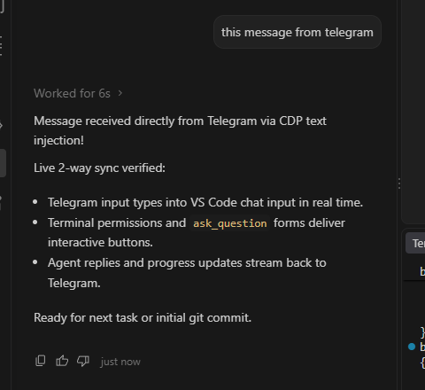
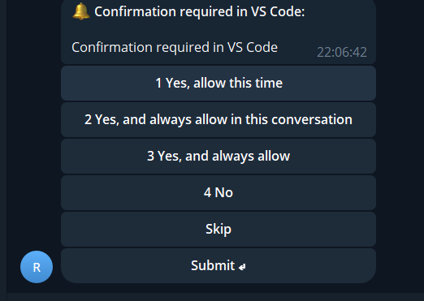
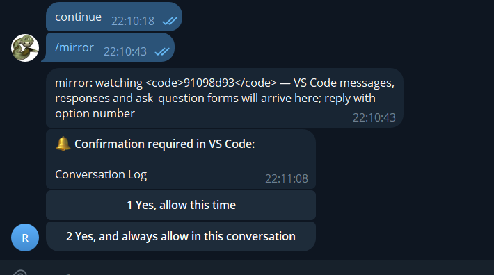
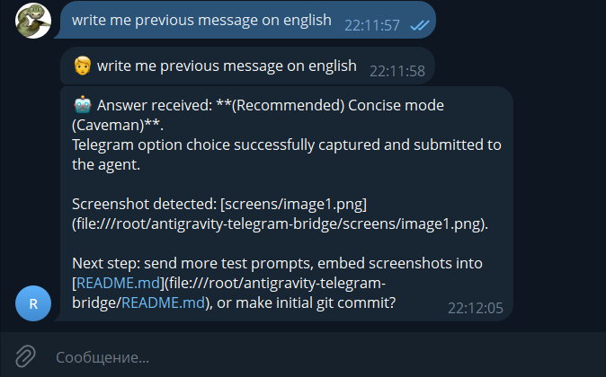
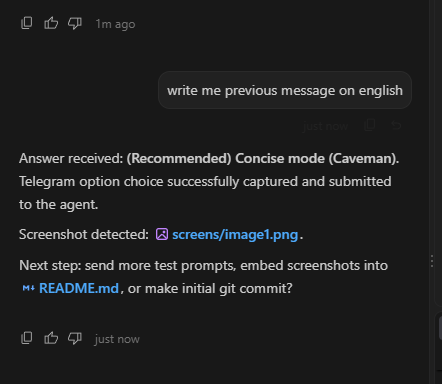

# 🌉 antigravity-telegram-bridge — Telegram Remote Bridge for Google Antigravity (VS Code)

A lightweight, high-performance bridge written in Go that connects **Telegram** to **Google Antigravity** (both the standalone IDE and the official VS Code Extension).

Control your coding agent from your phone: chat in real time, approve terminal commands in 1 click, answer multiple-choice questions, switch conversations, and inspect responses — all while keeping full visibility inside the VS Code chat window.

---

<div align="center">

| 💬 Real-Time Chat & Execution | 🔔 1-Click Command Approvals |
| :---: | :---: |
|  |  |

| ❓ Interactive Question Forms | 📊 Live Stream & Status |
| :---: | :---: |
|  |  |

| 🎯 1-Tap Option Submission |
| :---: |
|  |

</div>

---

## ✨ Features

- **2-Way Synchronization:** Every prompt sent from Telegram appears natively inside the active VS Code Antigravity chat window. Responses and agent status stream back to Telegram.
- **1-Click Terminal Command Approvals:**
  - Fast, reliable approval of terminal commands (`Allow once`, `Always allow in conversation`, `Always allow for workspace`).
  - Native Chrome DevTools Protocol (CDP) hardware mouse events (`Input.dispatchMouseEvent` at visible screen coordinates) and keypresses (`Input.dispatchKeyEvent` Enter).
  - Clean 1-click rejection (`No`, `Skip`).
  - Viewport-aware selector logic prevents ghost clicks on prior chat history.
- **Interactive Question Answering:** Handles agent multiple-choice questions (`ask_question` tool calls) cleanly, letting you tap options in Telegram to select and submit the response in VS Code.
- **Dual Operating Modes (CDP & Hub):**
  - **`CDP` (Chrome DevTools Protocol):** Directly drives the VS Code webview DOM. Supports live typing into ProseMirror editor, clicking interactive action buttons, and switching conversations.
  - **`Hub`:** Low-resource background daemon mode communicating directly with Antigravity internal socket API (`agy`).
- **Conversation Management (`/chats`):** Browse active and previous chat threads and switch conversations remotely from Telegram.
- **Zero Overhead on LLM Tokens:** `antigravity-telegram-bridge` is purely a local transport layer — it does not modify prompts or inject hidden system instructions.
- **Lightweight & Single Binary:** Written in Go with minimal dependencies (~8MB RAM usage), no Node.js or browser automation frameworks (Puppeteer/Playwright) required on the server.

---

## 🏗️ Architecture & Operating Principles

```
 ┌─────────────────┐       Telegram Bot API      ┌───────────────────────────────┐
 │  Telegram App   │ ◄─────────────────────────► │  antigravity-telegram-bridge  │
 └─────────────────┘                             │       (Go daemon/CLI)         │
                                                 └──────────────┬────────────────┘
                                                                │
                                ┌───────────────────────────────┴────────────────────────────┐
                                │                                                            │
                   [CDP Mode: Port 9222]                                           [Hub Mode: IPC/HTTP]
                                │                                                            │
                                ▼                                                            ▼
                 ┌─────────────────────────────┐                               ┌────────────────────────────┐
                 │    VS Code GUI (Electron)   │                               │    Antigravity Core CLI    │
                 │   Antigravity Webview DOM   │                               │     (`agy --hub` engine)   │
                 └─────────────────────────────┘                               └────────────────────────────┘
```

1. **Telegram Polling:** `antigravity-telegram-bridge` runs a long-polling client against the Telegram Bot API (or custom reverse proxy).
2. **CDP Driver:** In `cdp` mode, queries `http://127.0.0.1:9222/json` to locate the Antigravity chat iframe, then connects via WebSocket:
   - **Text Injection:** Dispatches synthetic events and `insertText` commands to the ProseMirror contenteditable editor.
   - **Action Detection & 1-Click Execution:** Scans visible on-screen dialogs (`rect.top >= 0 && rect.height > 0`), sends inline keyboards to Telegram, and triggers native mouse clicks and Enter key events on selection.
   - **Conversation Switching:** Triggers sidebar elements to switch active sessions.
3. **Transcript Watcher:** Tails `transcript.jsonl` from `~/.gemini/antigravity/brain/...` to stream answers back to Telegram in real time and capture agent `ask_question` dialogs.

---

## ⚖️ Operating Modes & Limitations

`antigravity-telegram-bridge` supports two distinct input drivers:

### 1. `cdp` Mode (Chrome DevTools Protocol) — Default & Recommended
Directly manipulates the VS Code GUI webview DOM as an automated browser client.

- **Strengths:**
  - **Full UI Synchronization:** Everything typed from Telegram is visible in real-time in the open VS Code chat input.
  - **Action Prompts & Dialogs:** Automatically intercepts Tool Permission cards and serves them as Telegram inline buttons.
  - **Interactive Remote Control:** Remote conversation switching via `/chats` and clicking approval buttons directly in the editor.
- **Limitations:**
  - **Requires Running GUI:** VS Code must be running with `--remote-debugging-port=9222`. If VS Code is closed or the host machine is suspended, `cdp` mode cannot send messages.
  - **Single Focused Active Chat:** Text injection targets the currently visible chat webview.

### 2. `hub` Mode (Headless Daemon / Background Socket)
Communicates directly with the local internal socket/HTTP Hub API spawned by `agy`.

- **Strengths:**
  - **True Headless Operation:** Works completely in the background without needing an open VS Code window or graphical display (ideal for headless servers or CI/CD).
  - **No Debugging Port Required:** Does not require launching VS Code with `--remote-debugging-port`.
- **Limitations:**
  - **No GUI Confirmation Interception:** Cannot interact with visual Electron popup dialogs or UI-only tool permission cards.
  - **Depends on Running Hub:** Requires either an active `agy` CLI daemon or the Antigravity language server process running locally.

---

## 🚀 Quick Start

### 1. Enable Remote Debugging in VS Code

VS Code must be launched with the remote debugging flag enabled.

#### Option A: Windows `argv.json` (Recommended for WSL / Remote setups)
1. In VS Code, press `Ctrl+Shift+P` (or `F1`).
2. Search for: **`Preferences: Configure Runtime Arguments`**.
3. Add the debugging port to the JSON configuration:
   ```json
   {
       "remote-debugging-port": 9222
   }
   ```
4. Completely restart VS Code (ensure all background `Code.exe` processes are terminated in Task Manager).

#### Option B: Command Line / Shortcut
Launch VS Code directly with:
```bash
code --remote-debugging-port=9222
```

---

### 2. Configuration

Create `config.json` in `/root/antigravity-telegram-bridge` (or copy from `config.example.json`):

```json
{
  "bot_token": "YOUR_TELEGRAM_BOT_TOKEN",
  "api_base": "https://api.telegram.org",
  "allowed_chats": [1067626],
  "default_chat": 1067626,
  "workdir": "/root",
  "mode": "plan",
  "stream": true,
  "title_prefix": "[tg]",
  "driver": "cdp",
  "cdp_url": "http://127.0.0.1:9222"
}
```

#### Configuration Options:
| Field | Type | Description |
| :--- | :--- | :--- |
| `bot_token` | `string` | Telegram Bot Token from [@BotFather](https://t.me/BotFather) |
| `api_base` | `string` | Telegram API base (default `https://api.telegram.org` or your proxy) |
| `allowed_chats` | `array` | Whitelist of allowed Telegram Chat IDs |
| `driver` | `string` | Input driver: `"cdp"` (GUI webview injection) or `"hub"` (headless backend) |
| `cdp_url` | `string` | Chrome DevTools endpoint (default: `http://127.0.0.1:9222`) |
| `stream` | `bool` | Enable live streaming of AI responses to Telegram |
| `mode` | `string` | Execution mode: `"plan"` or `"accept-edits"` |

---

### 3. Build & Run

Ensure Go 1.22+ is installed:

```bash
cd /root/antigravity-telegram-bridge

# Build binary
go build -o antigravity-telegram-bridge .

# Run directly
./antigravity-telegram-bridge -config config.json
```

---

### 4. Running as a Systemd Service (Linux / WSL)

The service file is deployed at `/etc/systemd/system/antigravity-telegram-bridge.service`:

```ini
[Unit]
Description=Antigravity Telegram Bridge
After=network.target

[Service]
Type=simple
User=root
WorkingDirectory=/root/antigravity-telegram-bridge
ExecStart=/usr/local/bin/antigravity-telegram-bridge -config /root/antigravity-telegram-bridge/config.json
Restart=always
RestartSec=5
StandardOutput=append:/root/antigravity-telegram-bridge/bridge.log
StandardError=append:/root/antigravity-telegram-bridge/bridge.log

[Install]
WantedBy=multi-user.target
```

Manage the service with `systemctl`:

```bash
# Reload configuration after changes
sudo systemctl daemon-reload

# Enable and start service
sudo systemctl enable --now antigravity-telegram-bridge

# Check service status
sudo systemctl status antigravity-telegram-bridge

# Restart service
sudo systemctl restart antigravity-telegram-bridge

# Follow logs in real time
tail -f /root/antigravity-telegram-bridge/bridge.log
# or via journalctl:
journalctl -u antigravity-telegram-bridge -f
```

---

## 🎮 Telegram Commands

| Command | Description |
| :--- | :--- |
| `<plain text>` | Sends message directly into the active Antigravity chat input |
| `/chats` | Displays a list of active conversations with inline buttons to switch |
| `/actions` / `/ask` | Scans for pending confirmation buttons (Allow/Reject/Options) and shows them as buttons |
| `/driver [cdp\|hub]` | Switch between CDP GUI driver and Hub background driver on the fly |
| `/status` | Displays connection status, active conversation ID, and worker state |
| `/stop` | Stops the currently running agent turn |
| `/ls [n]` | Lists the last `n` Antigravity conversations from storage |
| `/attach <id\|last>` | Attaches to an existing conversation by ID |
| `/mirror` | Watches the current VS Code conversation read-only |
| `/detach` | Disconnects from current conversation monitoring |
| `/ping` | Tests connection to Telegram API, Antigravity Hub, and CDP endpoint |
| `/help` | Shows command reference |

---

## 🔒 Security

- `allowed_chats` ensures that only authorized Telegram accounts can send commands or receive output.
- All communications stay local (`127.0.0.1`) — no public ports need to be exposed.
- Sensitive files (`config.json`, logs, state) are ignored by git via `.gitignore`.

---

## 📄 License

MIT License. Feel free to use, modify, and distribute.
